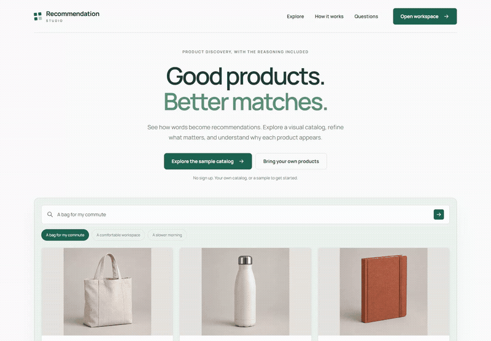

# Recommendation Studio

A basket-analysis tool for independent shops deciding what to offer together. Upload order history, find supported product pairs, compare the signal against a popularity baseline and export a bundle shortlist for merchandising review.

[Open the app](https://recommendation-studio-production.up.railway.app) | [GitHub Actions](https://github.com/Swarneil1905/recommendation-studio/actions) | [MIT license](LICENSE)

## See the outcome

[](docs/assets/walkthrough.mp4)

[Watch the short walkthrough](docs/assets/walkthrough.mp4). Recorded against the local MVP build with the real Java and Go services. It shows fictional purchases for an easy-to-follow example, then real historical retail data.

## Try it

1. Choose **Try real order data** to analyze 2,000 historical retail orders, or upload your own CSV.
2. Set minimum paired-order count, confidence and lift.
3. Inspect the order evidence for each product pair. Shortlist the pairs worth testing.
4. Check the held-out retrieval result against the popularity baseline.
5. Export the shortlist, verify current inventory and margins, then test placement in your own shop.

The output names an anchor product, a suggested add-on, supporting counts and a proposed placement. It helps select an experiment. It does not promise a sales increase or publish changes to a store.

## Your CSV

Use exactly `order_id,product_id,product_name`, with one product per order line. Repeated quantities count once. Remove customer names, emails and payment information. Limits: 10 to 5,000 orders, 1 to 30 products per order, 200 distinct products and 1 MB.

Product names stay in the browser. Only order IDs and product IDs are submitted for analysis. Requests are not persisted; export the shortlist before leaving.

## Algorithm and evaluation

Go mines directional, pairwise association rules from distinct baskets:

- **Support:** fraction of all orders containing both products.
- **Confidence:** fraction of anchor orders also containing the suggested product.
- **Lift:** confidence divided by the suggested product's overall purchase frequency. A lift of 1 indicates no association.

Thresholds filter weak evidence. Candidates are sorted by lift, paired-order count and stable product IDs, with at most 200 returned. No candidates is an explicit, valid result.

For evaluation, order-ID hashing holds out approximately 20% of orders. Rules are fitted only to training orders. One product is hidden from each eligible test basket; hit rate at 3 is compared with a training-only popularity baseline. This split is not chronological and does not measure future conversion or causal sales uplift. The displayed candidate list is separately fitted to all uploaded orders.

## Included data

The historical sample adapts **Chen, D. (2015), Online Retail**, UCI Machine Learning Repository, [DOI: 10.24432/C5BW33](https://doi.org/10.24432/C5BW33), licensed under [CC BY 4.0](https://creativecommons.org/licenses/by/4.0/).

It selects November 2011 positive merchandise purchases, projects baskets onto 100 popular products and takes the first 2,000 eligible invoices. Customer fields are excluded and order IDs replaced. This selection changes the distribution and is not current demand. Full attribution and transformations are in [ATTRIBUTION.txt](frontend/public/data/ATTRIBUTION.txt); rebuild using [prepare_retail_sample.py](tools/prepare_retail_sample.py) with the official ZIP and openpyxl 3.1.5.

A separate 240-order fictional dataset provides a simple worked example with illustrative product imagery. The historical dataset has no photos; SKU cards identify those products without inventing images.

## Additional catalog tool

Catalog search remains available from the workspace navigation. It supports TF IDF ranking, inventory and budget filters, preference comparisons and JSON catalog imports. It uses no paid AI API.

## How it works

```text
Angular interface → Java API → Go basket mining and catalog ranking
                         ↓                    ↓
                   catalog.json         30 second cache
```

| Component | Responsibility |
| --- | --- |
| Angular | Catalog imports, search filters, ranking comparison and result inspection |
| Java 21 | Catalog validation, inventory rules and HTTP API |
| Go | TF IDF ranking, saved product profiles and bounded result caching |
| Nginx | Frontend hosting and API proxy in Docker |

The Go service compares TF IDF vectors using cosine similarity. When a query and saved products are present, the query contributes 75% and the saved product profile contributes 25%. Without a query, the saved profile supplies the ranking. Stable product IDs break ties; similarity scores are not probabilities.

The cache holds at most 256 entries with a 30 second TTL and keys the complete ranking input. Java reloads the catalog on each request and applies stock, category, budget and saved item filters. A failed ranking request returns an explicit HTTP 503.

## Quick start with Docker

Requires Docker Desktop or Docker Engine with Compose. From the repository root:

```sh
docker compose up --build
```

Open **http://localhost:8082**. Analyze example order history or upload a CSV and export a bundle shortlist. Stop the stack with `docker compose down`.

## Run without Docker

Requires Go 1.26+, Java 21, Maven 3.9+ and Node.js 22.22+. Start each service in its own terminal from the repository root.

**Ranking service:**

```sh
cd ranker
go run .
```

**Catalog API on Windows:**

```powershell
cd api
mvn -B package
.\start-api.ps1
```

On macOS or Linux, replace the startup script with `java -jar target/catalog-api-1.0.0.jar`, keeping `api` as the working directory.

**Frontend:**

```sh
cd frontend
npm ci
npm start
```

Open **http://localhost:4202**. The Java API listens on port **8002** and the Go service on **8090**.

### Windows Java socket workaround

If Maven reports a loopback initialization error caused by a long temporary path, run the following from `api`, then retry the build:

```powershell
New-Item -ItemType Directory -Force .java-tmp | Out-Null
$socketDirectory = (Resolve-Path .java-tmp).Path
$env:JAVA_TOOL_OPTIONS = '-Djdk.net.unixdomain.tmpdir="' + $socketDirectory + '"'
mvn -B package
```

The startup script configures this directory for the API process automatically.

## Configuration and data

| Variable | Default | Purpose |
| --- | --- | --- |
| `CATALOG_PATH` | `catalog.json` | Catalog file, relative to the Java process working directory |
| `RANKER_URL` | `http://127.0.0.1:8090` | Go ranking service address |
| `PORT` | `8002` | Java API port |
| `BIND_ADDRESS` | `127.0.0.1` | Java API bind address |

Edit [`api/catalog.json`](api/catalog.json) to change the sample inventory. Replace it atomically if the API is running, so requests do not read a partially written file.

The preference profile and imported catalog live in the current page session and are sent to the API when building recommendations. Reloading the page clears them. Export results before leaving if you need a record. No purchase history or external tracking service is connected.

## Development checks

```sh
cd ranker
go test ./...
cd ../api
mvn test
cd ../frontend
npm run build
```

For HTTP integration checks, start both backend services and run from the repository root:

```sh
python -m pip install pytest httpx
python -m pytest tests -q
```

Tests cover ranking behavior, cache expiry, duplicate IDs, catalog filtering and the HTTP integration. GitHub Actions runs the Go and Java tests, frontend build and container builds. See the [verification notes](docs/verification.md) for the recorded browser checks and local results.

## Repository guide

| Path | Contents |
| --- | --- |
| `frontend/src/discover.ts` | Search, saved products and detail dialogs |
| `api/src/main/java/dev/swarneil/recommendation/CatalogServer.java` | Catalog service and inventory filters |
| `api/catalog.json` | Fictional sample inventory |
| `ranker/main.go` | Ranking implementation and TTL cache |
| `tests/` | HTTP integration checks |
| `docs/` | Architecture and verification details |

The public demo uses a rate limited gateway and a single replica. See [deployment and operations](docs/deployment.md) for CI/CD, resource limits and rollback. The catalog remains fictional sample inventory.

## Deployment and availability

The homepage is at `/`; the product workspace is at `/workspace`. The public Railway service uses sleep mode to reduce idle hosting costs. The first visit after inactivity can take longer while the service starts. Public requests are rate limited.

GitHub Actions checks frontend and backend code, builds the containers, tests the public HTTP path, and verifies both process failure handling and a clean Docker shutdown. Only a verified current `main` commit is promoted to the `production` branch that Railway deploys. A normal platform stop exits successfully; an unexpected required process exit fails the container.

See [deployment and operations](docs/deployment.md) for configuration and rollback, and [architecture](docs/architecture.md) for the service boundaries.

## License

Original project code is licensed under the [MIT License](LICENSE), copyright © 2026 Swarneil Pradhan. Bundled fonts retain their SIL Open Font Licenses in [`frontend/public/fonts`](frontend/public/fonts). Third party dependencies retain their respective licenses.
